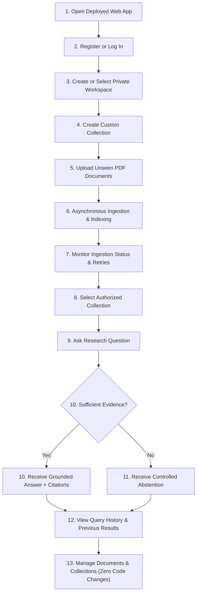
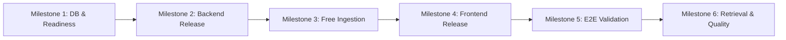

# Product Requirements Document (PRD)

## 1. Executive Summary & Product Vision

The **Document Intelligence & Research Platform** is a generalized, multi-user, self-service document research system with trustworthy, evidence-grounded AI answers. It empowers individuals and teams to create private workspaces, organize documents into custom collections, upload arbitrary PDF files from the browser, and query them with rigorous citation tracking, strict data isolation, and controlled abstention.

The platform originated as a specialized regulatory assistant for the Securities and Exchange Board of India (SEBI) Cybersecurity and Cyber Resilience Framework (CSCRF). While the original **SEBI CSCRF collection remains permanently supported as a specialized regulatory collection and foundational regression baseline**, the platform is fully generalized: any user can upload previously unseen PDF documents—such as corporate policies, technical specifications, research papers, or compliance manuals—and immediately perform evidence-grounded research.

### Core Architectural Pillars
1. **Self-Service Multi-Tenancy:** Authenticated users manage private workspaces, invite collaborators, create custom collections, and upload documents without touching code, manifests, or configuration files.
2. **Trustworthy, Grounded Answers:** Every factual assertion in an AI-generated answer is mechanically verified against retrieved source text chunks, complete with 1-indexed PDF page and printed page citations.
3. **Controlled Fail-Closed Abstention:** When evidence is missing, contradictory, or insufficient, the platform explicitly abstains from answering rather than hallucinating facts or fabricating citations.
4. **Pluggable Grounding Policies:** Specialized collections (such as SEBI CSCRF) enforce strict regulatory supersession and amendment graph traversal (`RegulatorySupersessionPolicy`). General document collections operate under an evidence-focused passthrough policy (`PassthroughPolicy`).
5. **Strict Tenant & Collection Isolation:** Data, storage objects, vector embeddings, lexical indices, and query histories are strictly segregated by workspace and collection. Cross-tenant leakage is zero-tolerance ($0.0\%$).
6. **Zero-Cost Hosting Architecture ($0/month):** Designed to operate within the free tiers of Render (Docker Web Service), Vercel (Frontend SPA), Neon (Serverless PostgreSQL), Backblaze B2 (S3-compatible Object Storage), and Groq (LLM Synthesis).

---

## 2. Target Users & Core Personas

| Persona | Primary Goal | Critical Need | Platform Experience |
| :--- | :--- | :--- | :--- |
| **Research Analyst / Associate** | Analyze internal corporate manuals, policy drafts, or technical whitepapers. | Needs instant upload, automatic indexing, and accurate page-referenced citations. | Private workspace, custom collection creation, drag-and-drop PDF upload, grounded Q&A. |
| **Compliance Officer / Legal Auditor** | Review regulatory mandates, compliance timelines, and amendment histories. | Requires tracking whether a specific provision was amended, superseded, or remains in force. | Access to the specialized `sebi_cscrf` collection with temporal graph evaluation. |
| **Engineering / DevOps Lead** | Query infrastructure playbooks, incident response guides, and architectural standards. | Needs exact operational checklists, command snippets, and source page provenance. | Access to technical collections (e.g. `cisa_playbooks` or internal team manuals). |
| **Returning Researcher** | Audit past findings, review previous Q&A sessions, and export citations. | Requires persistent, workspace-isolated query history and citation ledgers. | Query history drawer, session revisitation, and citation verification logs. |
| **Platform Administrator** | Maintain system demonstration collections, inspect ingestion queues, and audit health. | Needs administrative APIs, job status telemetry, and snapshot publication control. | Admin endpoints (`/api/v1/admin/*`), worker procedure inspection, and system metrics. |

---

## 3. End-to-End User Journeys

The platform supports 13 core user workflow capabilities:

1. **Access Web Application:** User visits the Vercel-hosted web interface.
2. **Authentication:** User creates a new account or logs in with email and password, receiving a secure session token.
3. **Workspace Management:** User selects an existing private workspace or creates a new one (e.g., "Risk Advisory Team").
4. **Collection Creation:** User creates a collection with a custom identifier, name, description, and grounding policy (e.g., `policy_name="general_static"`).
5. **Document Upload:** User uploads one or more PDF files via the web UI without modifying configuration files, manifests, or repository code.
6. **Automated Processing:** The backend validates file format, saves binaries to Backblaze B2, queues durable ingestion jobs, extracts text, chunks content, and builds search indices.
7. **Ingestion Monitoring:** User observes live ingestion status (`queued`, `processing`, `completed`, `failed`), review stage progress, and trigger retries on transient errors.
8. **Collection Selection:** User navigates to the Q&A interface and selects any authorized collection (private or public system demo).
9. **Question Submission:** User submits a natural language question scoped to the selected collection.
10. **Grounded Answer Synthesis:** The engine retrieves evidence, verifies citations, and generates a structured answer citing exact documents, chunk IDs, and page numbers.
11. **Controlled Abstention:** If the collection does not contain substantive evidence to answer the question, the system returns a structured `CONTROLLED_ABSTENTION` with an explicit reason.
12. **Query History:** The user reviews previous questions, answers, and verified excerpts in a persistent, private query history drawer.
13. **Lifecycle Management:** User manages documents and collections entirely through web UI actions.

---

## 4. Functional Requirements

### 4.1. Identity, Access & Workspaces (AUTH)
- **FR-AUTH-1 (User Registration & Login):** Secure registration and authentication using Argon2id password hashing and HS256/RS256 JWT session tokens.
- **FR-AUTH-2 (Automatic Personal Workspace):** Registration automatically provisions a default private workspace owned by the user.
- **FR-AUTH-3 (Workspace Memberships & Roles):** Support workspace roles (`owner`, `admin`, `member`, `viewer`) controlling creation, ingestion, and query permissions.
- **FR-AUTH-4 (Session Profile):** Provide `/api/v1/auth/me` returning user identity and accessible workspaces.

### 4.2. Workspace Collections & Ingestion (COLLECT)
- **FR-COLLECT-1 (Dynamic Collection Provisioning):** Authenticated users can create, list, and view private collections scoped to their workspace.
- **FR-COLLECT-2 (PDF Upload Streaming):** Accept multipart PDF uploads up to 30 MiB, validate `%PDF-` magic bytes, calculate SHA-256 digests, and stream directly to object storage.
- **FR-COLLECT-3 (Deduplication):** Reject or idempotently handle duplicate document uploads within a collection matching existing SHA-256 hashes.
- **FR-COLLECT-4 (Durable Job Enqueueing):** Enqueue ingestion tasks in PostgreSQL with initial status `queued` and stage `pending`.
- **FR-COLLECT-5 (Job Status Inspection):** Provide endpoints to inspect job processing status, stages, error summaries, and retry counters.
- **FR-COLLECT-6 (System Demonstration Collections):** Preserve `sebi_cscrf` and `cisa_playbooks` as read-only system collections accessible to all users for public demonstration and regression auditing. Modification of system collections by users is strictly forbidden (HTTP 403).

### 4.3. Document Processing Pipeline (INGEST)
- **FR-INGEST-1 (Text Extraction):** Extract text and page layout using PyMuPDF, recording text density quality (`OK`, `SPARSE`, `EMPTY`).
- **FR-INGEST-2 (Deterministic Chunking):** Chunk text using a 350-word sliding window with 40-word overlap, recording 1-indexed PDF page and printed page numbers.
- **FR-INGEST-3 (Durable Snapshot Publication):** Assemble published collections into atomic snapshots containing `chunks.json`, `documents.json`, lexical BM25 token tables, and dense vector matrices.
- **FR-INGEST-4 (Safe Leases & Retries):** Worker claims jobs atomically via `FOR UPDATE SKIP LOCKED` / procedure `app.claim_ingestion_job`, maintaining periodic heartbeats and supporting exponential backoff retries.

### 4.4. Retrieval, Grounding & Synthesis (RAG)
- **FR-RAG-1 (Collection-Scoped Search):** Every query must target a single explicit `collection_id`. Unscoped cross-collection search is strictly blocked.
- **FR-RAG-2 (Pluggable Grounding Policies):**
  - `REGULATORY_TEMPORAL`: Traverses directed amendment graphs (`AMENDS`, `RESCINDS`, `REFERENCES`) and evaluates `as_of` temporal dates (used for `sebi_cscrf`).
  - `GENERAL_STATIC`: Passthrough policy evaluating candidate relevance and citation overlap without regulatory supersession (used for general collections).
- **FR-RAG-3 (Mechanical Citation Verification):** Every claim assertion is verified against retrieved chunks. If citation validation fails, the system fails closed to verified extractive excerpts or controlled abstention.
- **FR-RAG-4 (Controlled Abstention):** Issue structured abstention (`disposition: CONTROLLED_ABSTENTION`) under the 5-point rubric: `insufficient_evidence`, `citation_verification_failed`, `conflicting_evidence`, `out_of_domain`, `temporal_uncertainty`.
- **FR-RAG-5 (Groq LLM Synthesis):** Generate natural language answers using Groq (`llama-3.3-70b-versatile`) via direct REST API with strict context prompt boundaries.

### 4.5. Query History & Audit (HIST)
- **FR-HIST-1 (Audit Persistence):** Record all authenticated query executions, dispositions, confidence metrics, citation counts, and latency in PostgreSQL table `query_history`.
- **FR-HIST-2 (Workspace Partitioning):** Users can only access query history belonging to their authenticated user account and authorized workspaces.
- **FR-HIST-3 (Session Revisitation):** Re-inspect past questions, answers, and verified excerpts from the web interface.

---

## 5. Non-Functional Requirements & System Constraints

1. **Strict Multi-Tenant Isolation:**
   - Database queries enforce workspace membership filters on all private tables.
   - Object storage keys are partitioned by `uploads/{workspace_id}/{collection_id}/{doc_id}.pdf`.
   - Unauthorized requests to private resources fail closed with HTTP 404 (preventing workspace/collection enumeration).
2. **Zero-Cost Hosting Target ($0/Month):**
   - Must operate within the free tiers of Render, Vercel, Neon, Backblaze B2, and Groq.
   - No paid Render background workers or paid Render web services.
   - No paid vector databases or external caching subscriptions.
3. **Resource & Memory Bounds:**
   - Render Free Web Service memory ceiling is strictly **512 MB RAM**.
   - Deployed web runtime uses lightweight lexical BM25 retrieval to ensure container stability.
   - Idle containers spin down after 15 minutes of inactivity; application startup must complete within Render health-check timeout (~30s).
4. **Deterministic Security & Secrets:**
   - Credentials (API keys, database URLs, B2 secrets) reside strictly in server environment variables and are never transmitted to the browser or printed to logs.
   - Password hashing uses Argon2id with recommended memory and iteration parameters.
5. **Documentation & Regression Integrity:**
   - The SEBI CSCRF 32-query golden evaluation suite (`evaluation/data/gold_evaluation_dataset.json`) remains a permanent regression anchor and must maintain 100% test pass fidelity.

---

## 6. Implementation Gap & Current Status

| Capability | Current State | Implementation Gap |
| :--- | :--- | :--- |
| **Authentication & Users** | Implemented locally (`backend/app/api/v1/auth.py`) | Blocked on applying Alembic migration `0006` to Neon and configuring `AUTH_SECRET_KEY` on Render. |
| **Private Workspaces** | Implemented locally (`backend/app/api/v1/workspaces.py`) | Blocked on migration `0006` and mounting UI components in `frontend/src/App.tsx`. |
| **Custom Collections** | Implemented locally (`backend/app/api/v1/collections.py`) | Blocked on migration `0006` and UI integration. |
| **PDF Document Upload** | Implemented locally (`collections.py:384-412`) | Blocked on configuring B2 credentials on Render and resolving worker execution. |
| **Worker Execution** | Daemon exists (`backend/app/ingestion/worker.py`) | **Open Architecture Gap:** Render background workers cost $7+/mo. Need a $0/mo execution strategy (external GitHub Actions runner, local CLI, or bounded execution). |
| **Live Web Deployment** | Active on Render (`71dc1ae`) | Currently running single-tenant demo in lexical mode; frontend on Vercel shows backend offline. |
| **Database Migrations** | Present locally (`0006`–`0009`) | Unapplied on live Neon production database (currently at revision `0005`). |
| **Frontend Integration** | Components exist in `frontend/src/components/*` | Untracked and unmounted in `App.tsx`; only default SEBI search form is visible. |

---

## 7. Definition of Minimum Viable Product (MVP)

The Generalized Document Intelligence Platform achieves **MVP Completion** when:
1. An unauthenticated user can register a new account on the deployed website.
2. The user is automatically assigned a private workspace and can create a custom collection.
3. The user can upload an unfamiliar PDF document (up to 30 MiB) via the browser.
4. The uploaded PDF is processed, chunked, and published into a searchable index.
5. The user can ask questions against their private collection and receive grounded answers with document/page citations.
6. Queries with insufficient evidence trigger a clean `CONTROLLED_ABSTENTION`.
7. Past queries and citations are visible in the user's private query history drawer.
8. A separate user account cannot view, access, or query the first user's collections or history (100% isolation).
9. The original SEBI CSCRF demonstration collection remains fully operational and accurate.
10. The entire system operates at **$0/month total infrastructure cost**.

---

## 8. Generalized Product Implementation Roadmap

### Milestone 1 — Production Readiness and Database Safety
- **Prerequisites:** Working repository, Neon database credentials, Render environment access.
- **Verified Neon Architecture:**
  - Branch `production`: Uninitialized (empty `neondb` database, zero application tables).
  - Branch `phase7-disposable`: Revision `0009_provision_api_runtime_role` confirmed, currently connected to Render via `sebi_api`.
  - Strategy: Option A (clean initialization of `production` branch to revision `0009`, credential rotation, and repointing Render).
- **Deliverables:**
  - Verify and resolve frontend/backend connectivity between Vercel and Render.
  - Audit Neon database migration state across branches.
  - Execute role bootstrap (`scripts/bootstrap_neon_roles.sql`) and apply Alembic migrations `0001`–`0009` against Neon `production` branch using direct connection (`neondb_owner`).
  - Set fresh, uncompromised credentials for `sebi_api` and `sebi_worker`.
  - Verify database role boundaries: `sebi_api` granted CRUD on application tables and SELECT on chunks; `sebi_worker` granted procedural execution only.
  - Repoint Render `DATABASE_URL` to `production` branch pooled endpoint.
- **Acceptance Tests:** `scripts/test_postgres_storage_live.py` passes cleanly against Neon `production` branch.
- **Status:** **READY FOR OPERATOR-EXECUTED INITIALIZATION** (Option A runbook fully documented; awaiting operator execution).

### Milestone 2 — Generalized Backend Release
- **Prerequisites:** Milestone 1 complete.
- **Deliverables:**
  - Configure Render environment variables: `AUTH_SECRET_KEY`, `STORAGE_PROVIDER=b2`, Backblaze B2 S3 credentials (`S3_ENDPOINT_URL`, `S3_BUCKET_NAME`, `S3_ACCESS_KEY_ID`, `S3_SECRET_ACCESS_KEY`, `S3_REGION_NAME`).
  - Commit and deploy local multi-tenant backend routers (`auth.py`, `workspaces.py`, `collections.py`, `query_history.py`, `relationship_policy.py`).
  - Verify API endpoints via automated integration test suite.
- **Acceptance Tests:** `test_tenant_isolation_matrix.py` (16 tests pass), `test_collection_ingestion_api.py` (passes).
- **Status:** **NOT STARTED**.

### Milestone 3 — Free-Tier Ingestion Execution
- **Prerequisites:** Milestone 2 complete.
- **Deliverables:**
  - Finalize $0/month worker execution strategy (evaluate external GitHub Actions runner, local operator CLI daemon, or bounded execution).
  - Implement secure execution triggering for claimed ingestion jobs.
  - Verify PDF text extraction, sliding-window chunking, and atomic snapshot publication to Backblaze B2.
  - Validate job leases, heartbeats, deduplication, and failure recovery.
- **Acceptance Tests:** Upload an unfamiliar PDF; worker processes and transitions job to `completed`; snapshot pointer is published in B2.
- **Status:** **NOT STARTED** (Worker execution strategy is an OPEN architectural decision).

### Milestone 4 — Generalized Frontend Release
- **Prerequisites:** Milestone 2 & Milestone 3 complete.
- **Deliverables:**
  - Integrate `AuthModal.tsx` for registration and login in React frontend.
  - Integrate `WorkspaceSelector.tsx` and `WorkspaceManageModal.tsx` for collection management and document uploads.
  - Add upload progress tracking and ingestion status polling.
  - Update `QueryForm.tsx` to support selecting private and public collections dynamically.
  - Mount `QueryHistoryDrawer.tsx` to display persistent query history and past citations.
  - Remove hardcoded SEBI-only presentation assumptions from general views while preserving specialized SEBI branding for the SEBI collection.
  - Deploy frontend updates to Vercel.
- **Acceptance Tests:** End-to-end browser walkthrough from signup to collection creation and upload.
- **Status:** **NOT STARTED**.

### Milestone 5 — End-to-End Generalization Validation
- **Prerequisites:** Milestone 4 complete.
- **Deliverables:**
  - Register a fresh user account on the public website.
  - Create a new workspace and private collection.
  - Upload a previously unseen multi-page PDF document.
  - Verify successful ingestion, indexing, and publication.
  - Submit domain questions and verify accurate answers with exact page citations.
  - Submit out-of-scope questions and verify controlled abstention.
  - Verify complete data isolation against a second user account.
  - Verify persistence across Render service sleep cycles and restarts.
- **Acceptance Tests:** Comprehensive manual and automated smoke test report documenting all 13 user journey capabilities.
- **Status:** **NOT STARTED**.

### Milestone 6 — Retrieval and Quality Improvements (Future Enhancements)
- **Prerequisites:** Milestone 5 complete.
- **Deliverables:**
  - Evaluate resource-compatible hybrid retrieval architectures (e.g., API-based dense embeddings via Groq/HuggingFace inference API or external embedding worker to preserve Render 512 MB limit).
  - Enhance document parser support (DOCX, Markdown, scanned PDF OCR) once PDF pipeline is hardened.
  - Implement fine-grained workspace team sharing and role-based permissions.
  - Implement query latency and cost observability dashboards.
- **Acceptance Tests:** Hybrid retrieval benchmarks exceeding pure lexical baseline within memory bounds.
- **Status:** **NOT STARTED** (Post-MVP enhancement).
