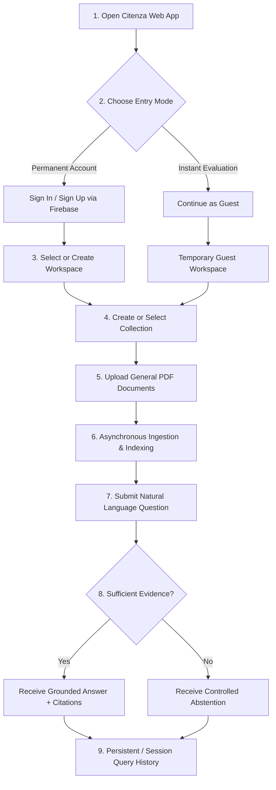

# Product Requirements Document (PRD) — Citenza

> **Citenza: Your documents. Verified answers.**

## 1. Executive Summary & Product Vision

Citenza is a general-purpose, multi-user AI document intelligence and research platform. It empowers individuals and teams to create private workspaces, organize documents into custom collections, upload arbitrary PDF files from the browser, and ask natural-language questions with verified source citations, strict data isolation, and deterministic abstention.

Citenza guarantees that every factual claim returned to the user is mechanically verified against retrieved source text chunks, complete with 1-indexed PDF page citations. When evidence is missing, conflicting, out-of-scope, or insufficient, Citenza explicitly abstains from answering rather than hallucinating or speculating.

### Core Architectural Pillars
1. **Self-Service Multi-Tenancy & Guest Mode:** Users can sign up and sign in using Firebase Authentication, manage private workspaces, or continue instantly as guests without creating permanent accounts.
2. **Trustworthy, Grounded Answers:** Every factual assertion in an AI-generated answer is mechanically verified against retrieved source text chunks, complete with 1-indexed PDF page and printed page citations.
3. **Controlled Fail-Closed Abstention:** When evidence is missing, contradictory, or insufficient, the platform explicitly abstains from answering (`disposition: CONTROLLED_ABSTENTION`).
4. **General-Purpose Grounding Policy:** Document collections operate under a strict evidence-verification policy (`GroundingPolicyType.GENERAL_STATIC`), enforcing verbatim citation validation and candidate retrieval binding without artificial domain restrictions.
5. **Strict Tenant & Collection Isolation:** Data, storage objects, vector embeddings, lexical indices, and query histories are strictly segregated by workspace and collection. Cross-tenant leakage is zero-tolerance ($0.0\%$).
6. **Zero-Cost Hosting Architecture ($0/month):** Designed to operate within the free tiers of Render (FastAPI Web Service), Vercel (React Frontend SPA), Neon (Serverless PostgreSQL), Backblaze B2 (S3-compatible Object Storage), and Groq (LLM Synthesis).

---

## 2. Target Users & Core Personas

| Persona | Primary Goal | Critical Need | Platform Experience |
| :--- | :--- | :--- | :--- |
| **Research Analyst** | Analyze internal corporate manuals, policy drafts, or technical whitepapers. | Instant upload, automatic indexing, and accurate page-referenced citations. | Private workspace, custom collection creation, drag-and-drop PDF upload, grounded Q&A. |
| **Operations / DevOps Lead** | Query infrastructure playbooks, incident response guides, and architectural standards. | Exact operational checklists, command snippets, and source page provenance. | Access to technical collections (e.g. `cisa_playbooks` or internal team handbooks). |
| **Guest Researcher** | Quickly evaluate document sets and test questions without committing credentials. | Instant evaluation with automatic resource cleanup upon expiration. | Isolated Guest Session, temporary upload quota, zero-friction research. |
| **Returning Researcher** | Audit past findings, review previous Q&A sessions, and export citations. | Persistent, workspace-isolated query history and citation ledgers. | Query history drawer, session revisitation, and citation verification logs. |
| **Platform Administrator** | Maintain demonstration collections, inspect ingestion queues, and audit health. | Administrative APIs, job status telemetry, and snapshot publication control. | Admin endpoints (`/api/v1/admin/*`), worker procedure inspection, and system metrics. |

---

## 3. End-to-End User Journeys

1. **Access Web Application:** User visits the Citenza web interface.
2. **Authentication:** User creates a permanent account via Firebase email verification, signs in, or initiates an instant Guest Session.
3. **Workspace Management:** User selects an existing private workspace or creates a new one (e.g., "Engineering Docs").
4. **Collection Creation:** User creates a collection with a custom identifier, name, and description.
5. **Document Upload:** User uploads one or more PDF files via the web UI without modifying configuration files or code.
6. **Automated Processing:** The backend validates file format, saves binaries to Backblaze B2, queues ingestion jobs, extracts text, chunks content, and builds search indices.
7. **Ingestion Monitoring:** User observes live ingestion status (`queued`, `processing`, `completed`, `failed`).
8. **Question Submission:** User submits a natural language question scoped to the selected collection.
9. **Grounded Answer Synthesis:** The engine retrieves evidence, verifies citations, and generates a structured answer citing exact documents, chunk IDs, and page numbers.
10. **Controlled Abstention:** If the collection does not contain substantive evidence, Citenza returns a structured `CONTROLLED_ABSTENTION` with an explicit reason.
11. **Query History:** User reviews previous questions, answers, and verified excerpts in a persistent query history drawer.

---

## 4. Functional Requirements

### 4.1. Identity, Access & Workspaces (AUTH)
- **FR-AUTH-1 (Firebase Authentication):** Secure registration and authentication using Firebase email/password with verification links.
- **FR-AUTH-2 (Automatic Personal Workspace):** Registration automatically provisions a default private workspace owned by the user.
- **FR-AUTH-3 (Guest Sessions):** Anonymous users can start a time-bounded guest session with isolated temporary workspace and upload quotas.
- **FR-AUTH-4 (Workspace Membership & RBAC):** Support workspace roles controlling creation, ingestion, and query permissions.
- **FR-AUTH-5 (Session Profile):** Provide `/api/v1/auth/me` returning user identity and accessible workspaces.

### 4.2. Workspace Collections & Ingestion (COLLECT)
- **FR-COLLECT-1 (Dynamic Collection Provisioning):** Authenticated users can create, list, and manage private collections scoped to their workspace.
- **FR-COLLECT-2 (PDF Upload Streaming):** Accept multipart PDF uploads up to 30 MiB, validate `%PDF-` magic bytes, calculate SHA-256 digests, and stream to Backblaze B2 storage.
- **FR-COLLECT-3 (Deduplication):** Idempotently handle duplicate document uploads within a collection matching existing SHA-256 hashes.
- **FR-COLLECT-4 (Durable Job Enqueueing):** Enqueue ingestion tasks in PostgreSQL with initial status `queued`.
- **FR-COLLECT-5 (Demonstration Collections):** Provide public, read-only system collections (`general_synthetic`, `cisa_playbooks`, `demo_finops`) for immediate exploration and verification.

### 4.3. Document Processing Pipeline (INGEST)
- **FR-INGEST-1 (Text Extraction):** Extract text and page layout using PyMuPDF, recording text density quality.
- **FR-INGEST-2 (Deterministic Chunking):** Chunk text using a 350-word sliding window with 40-word overlap, recording 1-indexed PDF page and printed page numbers.
- **FR-INGEST-3 (Durable Snapshot Publication):** Assemble published collections into atomic snapshots containing `chunks.json`, `documents.json`, lexical BM25 token tables, and dense vector matrices.
- **FR-INGEST-4 (Safe Leases & Retries):** Worker claims jobs atomically via `FOR UPDATE SKIP LOCKED` / procedure `app.claim_ingestion_job`, maintaining periodic heartbeats.

### 4.4. Retrieval, Grounding & Synthesis (RAG)
- **FR-RAG-1 (Collection-Scoped Search):** Every query must target a single explicit `collection_id`. Unscoped cross-collection search is strictly blocked.
- **FR-RAG-2 (Hybrid Retrieval):** Combine BM25 lexical ranking and dense vector embeddings (`BAAI/bge-small-en-v1.5`) via Reciprocal Rank Fusion (RRF).
- **FR-RAG-3 (Mechanical Citation Verification):** Every claim assertion is verified against retrieved chunks. If citation validation fails, the system fails closed to verified extractive excerpts or controlled abstention.
- **FR-RAG-4 (Controlled Abstention):** Issue structured abstention (`disposition: CONTROLLED_ABSTENTION`) under the rubric: `insufficient_evidence`, `citation_verification_failed`, `conflicting_evidence`, `out_of_domain`.
- **FR-RAG-5 (Groq LLM Synthesis):** Generate natural language answers using Groq (`llama-3.3-70b-versatile`) via direct REST API with strict context prompt boundaries.

### 4.5. Query History & Persistence (HIST)
- **FR-HIST-1 (Query History Ledger):** Record all submitted queries, dispositions, verified citations, and answers in PostgreSQL partitioned by workspace.
- **FR-HIST-2 (Session History Drawer):** Frontend drawer displaying chronological research ledger with instant inspection of past citations.
- **FR-HIST-3 (Guest Isolation):** Guest query history is isolated to the temporary guest session and purged upon expiration.
