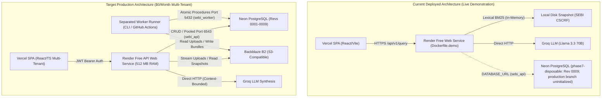
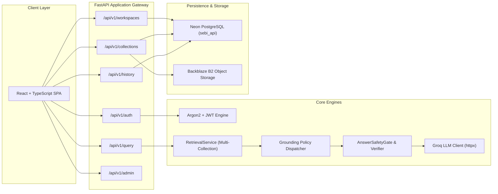
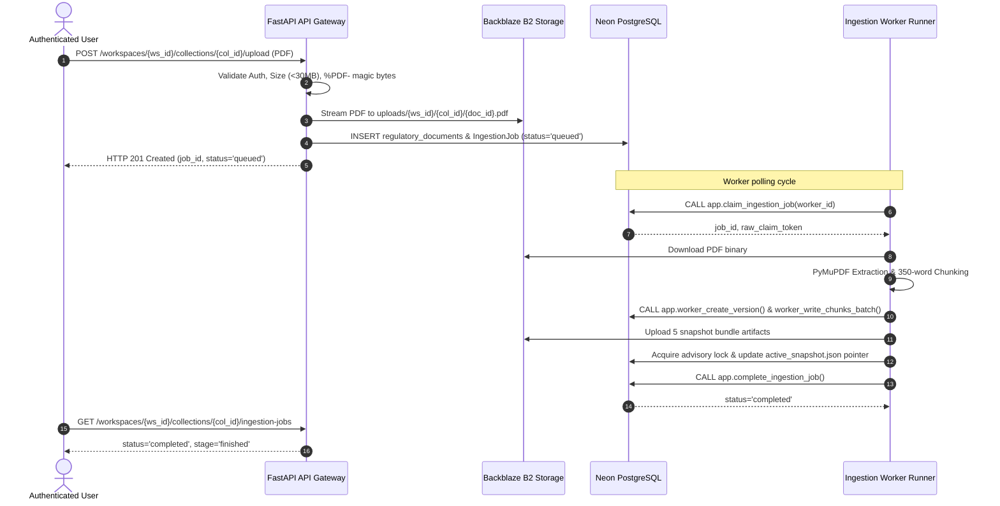
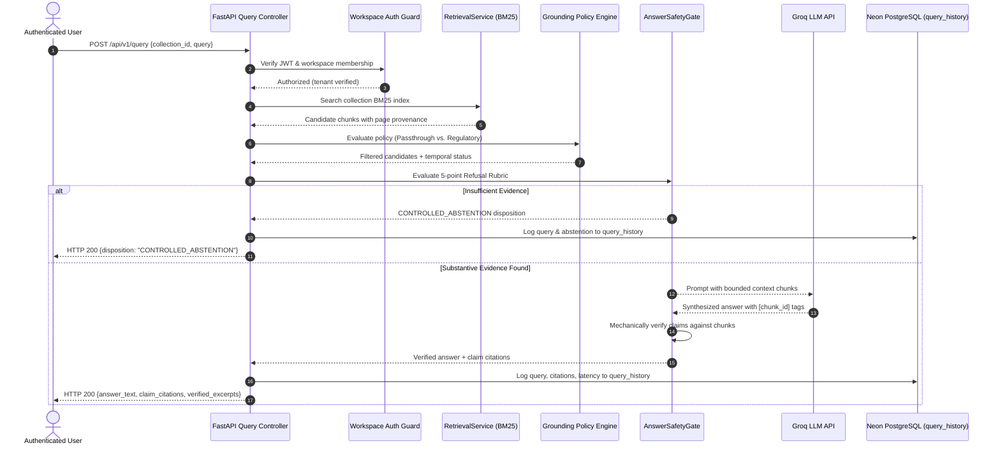

# System Architecture

## 1. Architectural Evolution & Current System States

The platform is transitioning from a specialized, single-tenant SEBI regulatory demonstration tool into a **generalized, multi-user, self-service Document Intelligence & Research Platform**. To provide complete architectural transparency, this document describes three distinct architectural views:
1. **Current Deployed Architecture:** The live, public demonstration service currently running in production.
2. **Local Generalized Architecture:** The fully developed, multi-tenant platform existing in the local repository worktree.
3. **Target Production Architecture:** The production deployment topology operating under a strict **$0/month hosting budget**.



---

## 2. Comparison of Architectural States

| Component / Layer | Current Deployed Architecture (`71dc1ae`) | Local Generalized Architecture (Worktree) | Target Production Architecture ($0/Month) |
| :--- | :--- | :--- | :--- |
| **Frontend UI** | Vercel React SPA (Single-tenant SEBI query form). Currently displays "Backend Offline". | React SPA with `AuthModal`, `WorkspaceSelector`, `WorkspaceManageModal`, `QueryHistoryDrawer`. | Vercel React SPA with full authentication, workspace, collection, and query history UI. |
| **Backend API** | Render Free Web Service running `Dockerfile.demo` (FastAPI). | FastAPI with `auth`, `workspaces`, `collections`, `query_history`, `admin`. | Render Free Web Service with multi-tenant routers and strict workspace authorization. |
| **Retrieval Engine** | In-memory lexical BM25 over static disk snapshot (`data/indexes/active_snapshot.json`). | Multi-collection `RetrievalService` supporting BM25, NumPy dense vectors, and PostgreSQL pgvector. | Memory-bounded multi-collection BM25 retrieval with lazy hydration from Backblaze B2. |
| **Grounding Policy** | Hardcoded regulatory circular relationship checks. | Pluggable policy architecture: `PassthroughPolicy` (general) vs. `RegulatorySupersessionPolicy` (SEBI). | Pluggable policy dispatch based on collection configuration (`policy_name`). |
| **Document Storage** | Ephemeral container filesystem (`data/raw/`, `data/processed/`). | Dual storage adapter: `LocalStorageAdapter` and `S3StorageAdapter` (B2 / S3). | Authoritative Backblaze B2 object storage partitioned by workspace and collection. |
| **Ingestion Pipeline** | Offline CLI manifest runner (`app.ingestion.cli`). | Asynchronous `IngestionWorker` with stored procedure leasing (`app.claim_ingestion_job`). | Separated worker runner (external free runner / CLI) processing queued jobs from Neon. |
| **Database Tier** | Neon PostgreSQL (`phase7-disposable` at Rev `0009`; `production` branch uninitialized). | Full multi-tenant schema locally defined in Alembic revisions `0001`–`0009`. | Neon PostgreSQL (`production` branch initialized to `0009`) with segregated roles (`sebi_api`, `sebi_worker`, `neondb_owner`). |
| **Monthly Cost** | **$0.00** | **$0.00** | **$0.00 target** (Strict free-tier allocation). |

---

## 3. Major System Components & Responsibilities



### 3.1. Client Layer (Vercel Frontend)
- Built with React 18, TypeScript, and Vite.
- Manages user sessions via local token storage and Axios request interceptors.
- Provides dynamic collection switching, multipart file upload with drag-and-drop, real-time ingestion job status polling, and query history inspection.

### 3.2. Application & Security Gateway (FastAPI Web Service)
- **Authentication & Security:** Argon2id password hashing, JWT creation/validation (`backend/app/core/auth.py`), and non-bypassable dependency injection guards (`require_workspace_reader`, `require_workspace_writer` in [`backend/app/api/workspace_deps.py`](file:///c:/Users/Raja/OneDrive/Desktop/sebi-rag-assistant/backend/app/api/workspace_deps.py)).
- **Multi-Tenant Routing:** Workspace-scoped collection routing (`/api/v1/workspaces/{workspace_id}/collections`).
- **File Upload Handler:** Streams binary PDF uploads directly to Backblaze B2, enforces 30 MiB size limits, verifies `%PDF-` magic bytes, calculates SHA-256 hashes, and enqueues database ingestion jobs.

### 3.3. Persistence Tier (Neon Serverless PostgreSQL)
- **Role Segregation:**
  - `sebi_api`: Connects via Neon's pooled endpoint (`-pooler:5432`). Granted scoped CRUD on `users`, `workspaces`, `workspace_memberships`, `collections`, `query_history`, and `regulatory_documents`. Granted SELECT-only on `chunks` and `chunk_embeddings`. Direct write access to chunks and execution of ingestion worker stored procedures are strictly blocked (`42501`).
  - `sebi_worker`: Connects via Neon's direct unpooled endpoint (`:5432`). Zero direct table write permissions on chunks or documents. State modifications occur exclusively through `SECURITY DEFINER` procedures owned by `worker_proc_owner`.
  - `neondb_owner`: Migration and administrative bootstrap role. Strictly prohibited from runtime API and worker processes.
- **Relational Tables:** Managed via Alembic migrations `0001`–`0009`.

### 3.4. Object Storage Tier (Backblaze B2)
- S3-compatible cloud object storage implementing `BaseStorageAdapter` ([`backend/app/storage/s3.py`](file:///c:/Users/Raja/OneDrive/Desktop/sebi-rag-assistant/backend/app/storage/s3.py)).
- **Storage Partitioning:**
  - Raw Uploaded PDFs: `uploads/{workspace_id}/{collection_id}/{document_id}.pdf`
  - Published Snapshot Bundles: `indexes/{collection_id}/snapshots/{snapshot_id}/{filename}`
  - Active Snapshot Pointers: `indexes/{collection_id}/active_snapshot.json`
- **Concurrency & Advisory Locking:** Because Backblaze B2 does not support S3 conditional `PutObject` (`If-None-Match: *`), snapshot pointer promotion uses PostgreSQL transaction-scoped advisory locks (`pg_try_advisory_xact_lock`) to prevent race conditions among concurrent workers.

### 3.5. Ingestion Queue & Worker Execution
- **Asynchronous Pull-Based Pipeline:** Uploading a document creates an `IngestionJobModel` row with `status="queued"` and `stage="pending"`.
- **Atomic Claiming:** Workers claim jobs using procedure `app.claim_ingestion_job`, which generates a secure claim token and hashes it (`claim_token_hash`) using `FOR UPDATE SKIP LOCKED`.
- **Execution Modules:** Text extraction via PyMuPDF ([`backend/app/ingestion/extractor.py`](file:///c:/Users/Raja/OneDrive/Desktop/sebi-rag-assistant/backend/app/ingestion/extractor.py)), sliding-window chunking ([`backend/app/ingestion/chunker.py`](file:///c:/Users/Raja/OneDrive/Desktop/sebi-rag-assistant/backend/app/ingestion/chunker.py)), and snapshot bundling ([`backend/app/retrieval/publisher.py`](file:///c:/Users/Raja/OneDrive/Desktop/sebi-rag-assistant/backend/app/retrieval/publisher.py)).

### 3.6. Retrieval & Grounding Engine
- **Collection-Scoped State:** `RetrievalService` maintains independent `CollectionRetrievalState` instances with LRU eviction (`max_cached_collections`, default 5) to fit within Render Free's 512 MB RAM.
- **Pluggable Grounding Policies ([`backend/app/grounding/relationship_policy.py`](file:///c:/Users/Raja/OneDrive/Desktop/sebi-rag-assistant/backend/app/grounding/relationship_policy.py)):**
  - `RegulatorySupersessionPolicy`: Resolves directed circular amendment chains (`AMENDS`, `RESCINDS`, `REFERENCES`) and evaluates `as_of` compliance dates for `sebi_cscrf`.
  - `PassthroughPolicy`: Skips regulatory supersession graphs and evaluates grounding directly against retrieved text for general collections.
- **Answer Safety Gate:** Mechanically verifies every claim assertion against retrieved chunks and page references, falling closed to `CONTROLLED_ABSTENTION` if evidence is insufficient or contradictory.
- **Synthesis:** Direct HTTP client (`httpx`) to Groq's OpenAI-compatible chat API (`llama-3.3-70b-versatile`).

---

## 4. End-to-End Data & Request Flows

### 4.1. Document Ingestion Lifecycle



### 4.2. Grounded Query Lifecycle



---

## 5. Free-Tier Operational Constraints & Mitigations

Hosting a multi-tenant Document Intelligence platform at **$0/month** requires strict adherence to vendor quotas:

```text
+-----------------------+-----------------------+-----------------------+
| Render Free API       | Neon Serverless DB    | Backblaze B2 Storage  |
| - 512 MB RAM Ceiling  | - 0.5 GB Storage Cap  | - 10 GB Free Storage  |
| - 15-min Sleep Timer  | - Inactivity Pause    | - 1 GB/Day Egress     |
| - Cold Start: 30-50s  | - Pooled vs. Direct   | - Advisory Lock Model |
+-----------------------+-----------------------+-----------------------+
           |                       |                       |
           +-----------------------+-----------------------+
                                   |
                                   v
             +-------------------------------------------+
             | Architectural Safeguards:                 |
             | 1. Lexical BM25 search in web container   |
             | 2. LRU collection cache (max 5 active)    |
             | 3. Separated worker execution (No paid RW)|
             | 4. B2 snapshot hydration on cold start    |
             | 5. Strict role segregation in Neon        |
             +-------------------------------------------+
```

1. **Render Free 512 MB RAM Ceiling:**
   - Dense vector embedding libraries (`sentence-transformers` + PyTorch) consume 350–450 MB RAM, leaving inadequate buffer and triggering Out-of-Memory (OOM) kills.
   - **Mitigation:** The live web container executes lightweight lexical BM25 retrieval (~80 MB RAM), which easily fits within 512 MB and supports concurrent queries.
2. **Render Background Worker Cost Constraint:**
   - Render Background Workers are a paid service ($7+/month). Under a $0/month budget, persistent background workers **cannot run on Render**.
   - **Mitigation (Open Architectural Decision):** Ingestion must execute via an external free runner (e.g. GitHub Actions workflow triggered on demand) or a developer/operator CLI daemon.
3. **Container Ephemerality & Sleeping:**
   - Render containers sleep after 15 minutes of inactivity and wipe ephemeral disk storage on restart.
   - **Mitigation:** Backblaze B2 is the authoritative storage tier. On cold start, `RetrievalService` hydratively downloads published collection snapshots into local cache with SHA-256 validation.
4. **Neon Connection Limits:**
   - High concurrency can exhaust Neon direct connection limits.
   - **Mitigation:** The API connects exclusively through Neon's PgBouncer connection pooler (`sebi_api`), reserving direct unpooled connections for migrations and worker procedures.

---

## 6. Security Boundaries & Threat Model

1. **Non-Enumerating Multi-Tenant Authorization:**
   - Unauthorized requests to private collections or workspaces fail closed with **HTTP 404 Not Found** (instead of HTTP 403 Forbidden). This prevents attackers from discovering valid workspace or collection IDs.
2. **Database Role Least Privilege:**
   - The web runtime identity (`sebi_api`) cannot execute `INSERT INTO chunks` or trigger stored procedures. In the event of an API remote code execution vulnerability, the attacker cannot corrupt the vector index or impersonate the worker.
3. **Prompt Injection & Evidence Containment:**
   - Extracted PDF text is treated as untrusted user data. Prompts strictly delimit evidence chunks, and `CitationValidator` ensures that the model cannot cite arbitrary strings not present in retrieved context.
4. **System Demonstration Protection:**
   - System collections (`sebi_cscrf`, `cisa_playbooks`) have `is_system = true` and `is_public = true`. The API rejects any write, upload, or delete attempt targeting system collections with **HTTP 403 Forbidden**.

---

## 7. Cross-Reference to Implementation Roadmap

The full phased rollout plan from the current deployed state to the generalized target architecture is detailed in [docs/PRD.md](file:///c:/Users/Raja/OneDrive/Desktop/sebi-rag-assistant/docs/PRD.md#8-generalized-product-implementation-roadmap) and operationalized in [docs/deployment-runbook.md](file:///c:/Users/Raja/OneDrive/Desktop/sebi-rag-assistant/docs/deployment-runbook.md):
- **Milestone 1:** Production Readiness and Database Safety (Neon migrations `0006`–`0009`).
- **Milestone 2:** Generalized Backend Release (Render environment configuration and multi-tenant routers).
- **Milestone 3:** Free-Tier Ingestion Execution (Worker execution strategy).
- **Milestone 4:** Generalized Frontend Release (Vercel UI integration).
- **Milestone 5:** End-to-End Generalization Validation (Complete walkthrough verification).
- **Milestone 6:** Retrieval and Quality Improvements (Resource-compatible hybrid retrieval).
