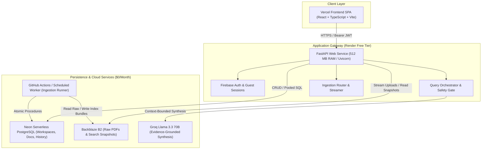
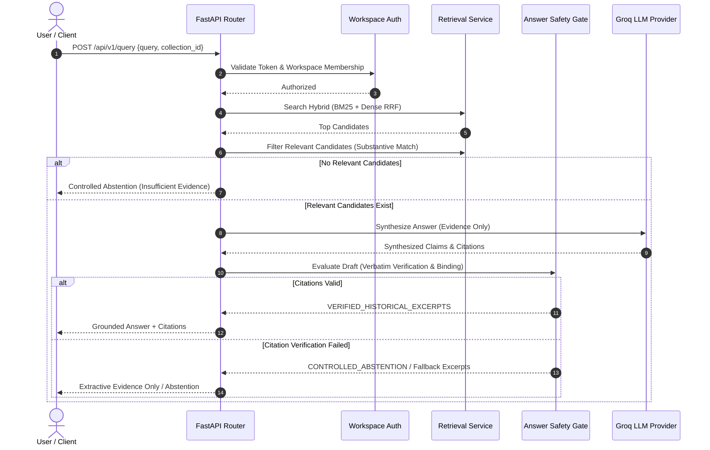

# Citenza — System Architecture

> **Your documents. Verified answers.**

## 1. Architectural Overview

Citenza is a production-grade, multi-user, self-service AI document intelligence platform designed to operate on a strict **$0/month hosting budget**.

---

## 2. Component Layers & Responsibilities

### 2.1. Client Layer (Vercel)
- **Framework:** React 18, TypeScript, Tailwind CSS, Vite.
- **Authentication:** Firebase Authentication Client SDK with verification links, plus instant Guest Mode session initiation.
- **Workspace Navigation:** Dynamic workspace selector, collection switcher, and persistent research history drawer.
- **Q&A Interface:** Natural-language query submission, answer card display, verified evidence drawer, and 1-indexed PDF page citation inspector.

### 2.2. Application Gateway (Render)
- **Framework:** FastAPI running on Python 3.12 with Uvicorn.
- **Authentication & Authorization:**
  - Firebase token validation via Firebase Admin SDK / JWKS.
  - Automatic workspace provisioning on first authenticated request.
  - Fail-closed workspace authorization: unauthorized access returns HTTP 404 to prevent enumeration.
- **Ingestion Streaming:** Receives multipart PDF streams, validates `%PDF-` magic bytes, computes SHA-256 digests, and streams to Backblaze B2.
- **Query Pipeline:**
  - Collection-scoped hybrid retrieval (BM25 lexical + dense vector search via `BAAI/bge-small-en-v1.5`).
  - Substantive relevance filtering ensuring candidate passages directly address query terms.
  - Mechanical `AnswerSafetyGate` validating claim citations against retrieved candidate chunks verbatim.
  - Grounded synthesis dispatch to Groq (`llama-3.3-70b-versatile`) with strict fallback to `MockSynthesisProvider` for offline testing.

### 2.3. Data & Storage Tier
- **Database (Neon PostgreSQL):**
  - Multi-tenant relational schema: `users`, `workspaces`, `workspace_memberships`, `collections`, `documents`, `chunks`, `ingestion_jobs`, `query_history`, `guest_sessions`.
  - Stored procedures: atomic job claiming (`app.claim_ingestion_job`) and guest expiration cleanup.
  - Direct connection (Port 5432) for schema migrations and pooled connection (Port 6543) for runtime API traffic.
- **Object Storage (Backblaze B2):**
  - S3-compatible object storage for immutable raw PDF binaries and published index snapshot bundles (`chunks.json`, `documents.json`, `dense_index.npy`, `manifest.json`).
- **Synthesis Provider (Groq):**
  - High-throughput inference for `llama-3.3-70b-versatile` executing under strict JSON contracts and evidence context limits.

---

## 3. End-to-End Query & Grounding Flow

---

## 4. Multi-Tenant Isolation Model

1. **Workspace Boundary:** Every collection, document, chunk, and query history record is strictly associated with a `workspace_id` UUID.
2. **Collection Isolation:** Ingestion indices and search queries operate strictly within a single `collection_id`. Cross-collection fusion is prohibited.
3. **Guest Session Isolation:** Guest users receive a dedicated temporary workspace with strict TTL expiration and automatic resource cleanup.
4. **Zero-Leakage Enforcement:** All queries and lookups require workspace authorization checks; unauthorized requests return HTTP 404.
