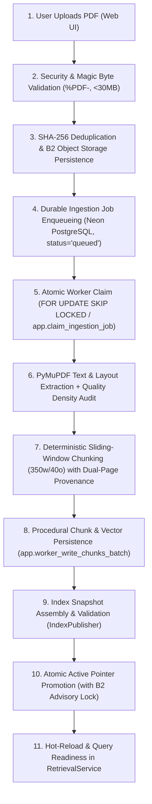

# Data Pipeline & Ingestion Architecture

## 1. Overview: The Generalized Ingestion Lifecycle

The platform uses a deterministic, multi-stage ingestion pipeline to transform unstructured PDF documents into structured, provenance-annotated, searchable text chunks and index snapshots. 

While the pipeline originally supported only static SEBI circular manifests, it is now fully generalized: users can upload arbitrary PDF documents from the web interface, which are stored in durable object storage, processed asynchronously through a durable PostgreSQL job queue, indexed, and atomically published for search.



---

## 2. Ingestion Stages & State Machine

Every document ingestion workflow is tracked as a durable state machine in PostgreSQL table `ingestion_jobs` ([`backend/app/persistence/models.py`](file:///c:/Users/Raja/OneDrive/Desktop/sebi-rag-assistant/backend/app/persistence/models.py)):

```text
+---------------------------------------------------------------------------------------+
| Ingestion Job Statuses:                                                               |
|   - queued: Waiting for available worker claim                                         |
|   - processing: Claimed and actively being processed under lease                       |
|   - completed: Successfully extracted, chunked, indexed, and snapshot published       |
|   - failed: Errored out after retries or fatal parse exception                         |
+---------------------------------------------------------------------------------------+
| Lifecycle Stages:                                                                     |
|   pending -> parsing -> chunking -> embedding -> persisting -> indexing -> finished  |
+---------------------------------------------------------------------------------------+
```

### 2.1. Stage Descriptions
1. **`pending` (`status="queued"`):** File stream validated, SHA-256 recorded, uploaded to Backblaze B2, and inserted into `ingestion_jobs`.
2. **`parsing` (`status="processing"`):** Worker claims job, opens temporary streaming handle from B2, and executes PyMuPDF page-by-page extraction.
3. **`chunking`:** Extracted text is segmented into deterministic 350-word chunks with 40-word overlap, capturing physical PDF page and printed page strings.
4. **`embedding`:** In dense or hybrid modes, vectors are computed. In lexical-only mode, token matrices are generated.
5. **`persisting`:** Worker invokes `app.worker_write_chunks_batch` to commit chunk records and vector arrays to PostgreSQL.
6. **`indexing`:** Search indexes (BM25 inverted token catalog, vector matrices) and metadata manifests are compiled into an isolated staging directory.
7. **`finished` (`status="completed"`):** Authoritative active pointer is atomically updated in B2 and PostgreSQL; worker lease is cleared; completion timestamp is recorded.

---

## 3. Worker Procedures, Leases & Concurrency Control

Worker execution is strictly decoupled from the web API and secured through database procedures:

1. **Atomic Job Claiming (`app.claim_ingestion_job`):**
   - Uses `FOR UPDATE SKIP LOCKED` to prevent lock contention among concurrent workers.
   - Generates a cryptographically random 256-bit raw claim token returned only to the claiming worker session.
   - Computes and stores only the SHA-256 digest (`claim_token_hash`) in `ingestion_jobs`.
   - Sets `lease_expires_at = clock_timestamp() + lease_duration` (default 60s).
2. **Heartbeat Maintenance (`app.heartbeat_ingestion_job`):**
   - Long-running PDF processing jobs refresh `lease_expires_at` periodically to prevent premature reassignment.
3. **Stale Lease Recovery (`app.recover_stale_jobs`):**
   - If a worker crashes or loses network connectivity, jobs with expired leases are automatically returned to `queued` status if `attempt_count < max_attempts` (default 3), or transitioned to `failed`.
4. **Idempotency & Deduplication:**
   - Uploading an identical document (matching SHA-256) within the same workspace and collection detects the existing job. Redundant uploads are cleaned up immediately, and the caller receives the existing job status without duplicate re-indexing.
5. **Backblaze B2 Pointer Promotion Lock:**
   - Because Backblaze B2 does not support S3 conditional `PutObject` (`If-None-Match: *`), updating `active_snapshot.json` uses a PostgreSQL advisory lock (`pg_try_advisory_xact_lock`). If another worker holds the promotion lock, the candidate worker retries with exponential backoff.

---

## 4. Text Extraction & Chunking Strategy

### 4.1. Extraction Quality Density Auditing
Using PyMuPDF ([`backend/app/ingestion/extractor.py`](file:///c:/Users/Raja/OneDrive/Desktop/sebi-rag-assistant/backend/app/ingestion/extractor.py)), each page is classified by extracted character density:
- **`OK`:** Character count $\ge 200$. Clean, high-density selectable text.
- **`SPARSE`:** $1 \le \text{characters} < 200$. Flagged for potential tables, scanned fragments, or title pages.
- **`EMPTY`:** 0 characters extracted. Flagged as image-only or unreadable.

### 4.2. Deterministic Sliding-Window Chunking
Implemented in [`backend/app/ingestion/chunker.py`](file:///c:/Users/Raja/OneDrive/Desktop/sebi-rag-assistant/backend/app/ingestion/chunker.py):
- **Window Size:** **350 words** with **40-word overlap**.
- **Stable Identifiers:**
  $$\text{chunk\_id} = \{\text{document\_id}\}\_\text{p}\{\text{page\_start}\}\_\{\text{chunk\_idx}\}$$
  Example: `doc_9a8b7c_p4_2`.
- **Dual-Page Provenance:** Every chunk tracks both its physical 1-indexed PDF page (`page_start`, `page_end`) and document printed page strings (`printed_page_start`, `printed_page_end`).

---

## 5. Search Index Snapshot Publication & B2 Hydration

To prevent queries from reading partially written indexes, search indexes are published as **immutable snapshot bundles** ([`backend/app/retrieval/publisher.py`](file:///c:/Users/Raja/OneDrive/Desktop/sebi-rag-assistant/backend/app/retrieval/publisher.py)):

### 5.1. The 5 Immutable Bundle Artifacts
Every published snapshot directory (`indexes/{collection_id}/snapshots/{snapshot_id}/`) contains:
1. `chunks.json`: Complete chunk records with full text and dual-page provenance.
2. `documents.json`: Parent document metadata (titles, circular numbers, SHA-256 hashes).
3. `dense_index.npy` (or `bm25_index.pkl`): Embedding matrix or inverted BM25 token tables.
4. `dense_index_meta.json`: Embedding model dimensions and normalization parameters.
5. `manifest.json`: Cryptographic manifest containing SHA-256 hashes of all bundle artifacts.

### 5.2. Atomic Pointer Swapping
The authoritative active pointer is maintained at:
- Remote: `indexes/{collection_id}/active_snapshot.json`
- Local: `data/indexes/{collection_id}/active_snapshot.json`

Only after all 5 artifacts are verified against the manifest is the active pointer rewritten.

### 5.3. Cold-Start Hydration from Backblaze B2
When a Render Free container spins up after sleep:
1. `RetrievalService` checks if the local cache has the active snapshot.
2. If absent or stale, it downloads the bundle into an isolated staging folder (`_staging_hydrate_*`).
3. Verifies artifact checksums against `manifest.json`.
4. Atomically renames the directory to `snapshots/{snapshot_id}/` and updates the local pointer.

---

## 6. The $0/Month Ingestion Worker Execution Strategy

### Current Status: OPEN Architectural Decision
In local testing, the ingestion worker runs via `python -m app.ingestion.worker` ([`backend/app/ingestion/worker.py`](file:///c:/Users/Raja/OneDrive/Desktop/sebi-rag-assistant/backend/app/ingestion/worker.py)). 

However, **Render Background Workers are a paid service ($7+/month)** and cannot run on the free tier. Running heavy PDF extraction and PyTorch embeddings inside Render Free's 512 MB Web Service container risks Out-Of-Memory (OOM) kills.

To maintain a **$0/month hosting budget**, the worker execution strategy evaluates three feasible, genuinely free alternatives:

| Alternative | Execution Mechanism | Pros | Cons / Constraints | Status |
| :--- | :--- | :--- | :--- | :--- |
| **Option 1: External GitHub Actions Runner** | Scheduled workflow (`cron: "*/10 * * * *"`) or webhook trigger | Free (2,000 min/mo), 7 GB RAM, isolated compute, zero Render memory impact. | Delayed start latency (~30–60s for runner spin-up); requires GitHub repository secret setup. | **Under Evaluation** |
| **Option 2: Local Operator CLI Daemon** | Operator runs `python -m app.ingestion.worker` on local machine | Zero cloud cost, instantaneous processing, full access to local CPU/RAM. | Requires operator machine to remain online while processing jobs; not fully autonomous. | **Operational Default for Development** |
| **Option 3: Bounded In-Process Worker / Endpoint** | Bounded async task or administrative `/process-next` trigger inside API | Autonomous, zero external runner needed. | Must bound PDF processing to stay under 512 MB RAM; risk of container restart during large PDF chunking. | **Under Evaluation (Lexical Only)** |

---

## 7. Specialized SEBI Regulatory Ingestion Pipeline (Baseline Preservation)

The original SEBI CSCRF circular corpus (`sebi_cscrf_2024_113`, `2025_045`, `2025_060`, `2025_096`, `2025_119`) remains preserved as a specialized collection pipeline:
- **Declarative Manifest:** Defined in `data/manifests/sebi_cscrf.json`.
- **Regulatory Graph Edges:** Contains 9 verified regulatory relationships (`AMENDS`, `RESCINDS`, `REFERENCES`) with clause-specific provision scopes (`affected_provisions`).
- **Policy Enforcement:** Bound to `RegulatorySupersessionPolicy`, enabling multi-hop temporal traversals.
- **Permanent Regression Anchor:** Pinned to snapshot `snap_20261011_104512_23a014` and verified against the 32 golden queries in `evaluation/data/gold_evaluation_dataset.json`.
