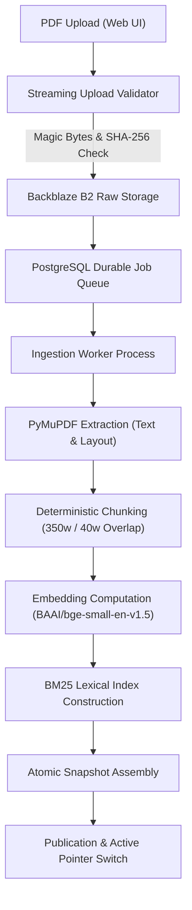

# Citenza — Data Ingestion & Processing Pipeline

> **Your documents. Verified answers.**

## 1. Pipeline Overview

Citenza's ingestion pipeline transforms arbitrary PDF files into searchable, mathematically grounded knowledge collections.

---

## 2. Ingestion Stages

### Stage 1: Upload Validation & Streaming
- Validates file format by checking `%PDF-` header magic bytes.
- Computes SHA-256 cryptographic hash during streaming.
- Enforces 30 MiB size limit.
- Streams the raw binary directly into Backblaze B2 object storage under `workspaces/{workspace_id}/collections/{collection_id}/raw/{document_id}.pdf`.
- Idempotently prevents duplicate uploads within the same collection.

### Stage 2: Asynchronous Job Enqueueing
- Creates an `ingestion_jobs` record in Neon PostgreSQL with initial state `queued`.
- Supports atomic job claiming via stored procedure `app.claim_ingestion_job(worker_id, lease_timeout_seconds)`.
- Implements `FOR UPDATE SKIP LOCKED` for lock contention prevention.

### Stage 3: Deterministic Text Extraction
- Uses PyMuPDF (`fitz`) for fast, robust text extraction.
- Analyzes text density and flags pages as `OK`, `SPARSE`, or `EMPTY`.
- Records physical PDF page numbers (1-indexed) and printed page numbers for citation provenance.

### Stage 4: Sliding-Window Chunking
- Chunks text using a sliding window of 350 words with a 40-word overlap.
- Records exact start and end page boundaries (`page_start`, `page_end`).
- Stores chunk records containing clean text, character counts, and word offsets.

### Stage 5: Hybrid Index Generation
- Computes 384-dimensional dense embeddings using `BAAI/bge-small-en-v1.5`.
- Builds BM25 Okapi inverted lexical index tables for exact keyword and term matching.

### Stage 6: Atomic Snapshot Publication
- Assembles index assets into a versioned snapshot directory:
  - `manifest.json`: Document and chunk count, timestamp, checksum.
  - `documents.json`: Full document metadata records.
  - `chunks.json`: Complete chunk text and provenance.
  - `dense_index.npy`: Dense vector matrix (when in hybrid mode).
  - `dense_index_meta.json`: Embedding model name and dimensionality.
- Atomically promotes the new snapshot via `active_snapshot.json` pointer update.
