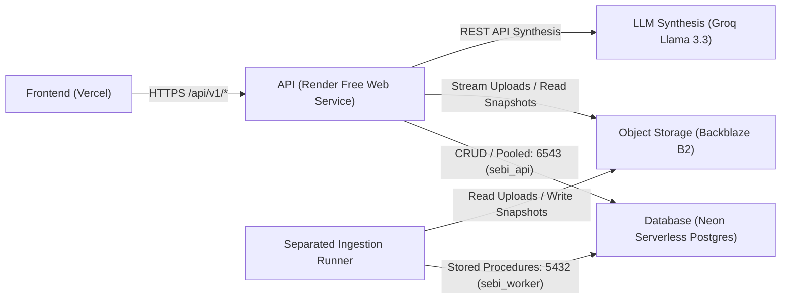

# Deployment & Operations Runbook

## 1. Hosting Architecture Overview & Operating Objectives

This runbook documents the safe operational rollout path from the current deployed single-tenant demonstration service to the **generalized, multi-user Document Intelligence & Research Platform** under a strict **$0/month hosting budget**.



> [!WARNING]
> **Free-Tier Operational Boundaries:**
> 1. **No Cloud Provider is Permanently Free:** Quotas, inactivity sleep rules, and terms are subject to provider change. Operating at $0/month requires ongoing vigilance and resource capping.
> 2. **Render Web Service Limits:** 512 MB RAM ceiling, 0.1 vCPU, 15-minute inactivity spin-down. Cold start takes 30–50s.
> 3. **Render Background Worker Cost Constraint:** Render background workers are a **paid service ($7+/month)**. Under a $0/month budget, persistent background workers **cannot run on Render**. Ingestion worker execution is an open architectural decision (see Section 7).
> 4. **Neon Serverless Inactivity:** Neon database compute auto-suspends after inactivity; initial reconnect incurs a 2–3s wake-up delay.
> 5. **Secret Protection:** Never document or commit real credentials. Use variable names only.

---

## 2. Current Confirmed Deployment State

As of commit [`71dc1ae`](file:///c:/Users/Raja/OneDrive/Desktop/sebi-rag-assistant/Dockerfile.demo):
- **Render Web Service:** `sebi-circular-rag-assistant`
- **Runtime:** Docker (`Dockerfile.demo`, build context `.`)
- **Deployment Status:** Live (FastAPI startup successful, `/health` returns HTTP 200)
- **Dependency Fix:** `ModuleNotFoundError: No module named 'sqlalchemy'` resolved via `backend/requirements-demo.txt`.
- **Active Search Engine:** Pure-Python lexical BM25 (~80 MB RAM).
- **Vercel Frontend:** Deployed, but current UI screenshot displays "Backend Offline" due to unverified API base URL proxying.
- **Neon Database:** Operational across two branches:
  - Branch `phase7-disposable`: Confirmed at Alembic revision `0009_provision_api_runtime_role` with provisioned roles. Currently targeted by Render `DATABASE_URL`.
  - Branch `production`: Confirmed uninitialized (empty database `neondb`, no application tables, no `alembic_version`).
  - Target transition: Option A (clean initialization of `production` branch to revision `0009`, credential rotation, and repointing Render).
- **Multi-Tenant Routers & B2 Storage:** Implemented in local worktree; pending release.

---

## 3. Environment Variable Inventory (Production & Staging)

All variables utilized across the web API and ingestion worker are cataloged below. **Do not put secrets into repository files.**

| Variable Name | Target Service | Secret? | Purpose & Safe Configuration Guidelines |
| :--- | :--- | :---: | :--- |
| `APP_ENV` | Render Web Service | No | Set to `production` or `staging`. Enforces strict production role and CORS validation. |
| `DATABASE_URL` | Render Web Service | **Yes** | Neon pooled connection string on port 5432 or 6543 (`-pooler.ap-southeast-1.aws.neon.tech`). Authenticates strictly as restricted role `sebi_api`. |
| `WORKER_DATABASE_URL` | Worker Runner | **Yes** | Neon direct unpooled connection string on port 5432. Authenticates strictly as restricted role `sebi_worker`. **Do not remove or merge into `DATABASE_URL`**; code strictly forbids silent fallback. |
| `DIRECT_DATABASE_URL` | Operator Local CLI | **Yes** | Neon direct unpooled connection string on port 5432 authenticating as `neondb_owner`. **Reserved strictly for running migrations and role bootstrap.** Never set in Render or Vercel. |
| `AUTH_SECRET_KEY` | Render Web Service | **Yes** | Cryptographic key ($\ge 32$ characters) used for signing Argon2/JWT session tokens. |
| `AUTH_TOKEN_EXPIRE_MINUTES` | Render Web Service | No | Access token expiration duration in minutes (default: `60`). |
| `STORAGE_PROVIDER` | Render Web Service | No | Set to `b2` (or `s3`). Instructs the backend to use `S3StorageAdapter` for Backblaze B2. |
| `S3_ENDPOINT_URL` | Render Web Service | No | Backblaze B2 S3-compatible endpoint (e.g. `https://s3.us-east-005.backblazeb2.com`). |
| `S3_BUCKET_NAME` | Render Web Service | No | Name of private Backblaze B2 bucket (e.g. `sebi-rag-storage-prod`). |
| `S3_REGION_NAME` | Render Web Service | No | Must match the region in the endpoint (e.g. `us-east-005`). Backblaze B2 rejects `'auto'`. |
| `S3_ACCESS_KEY_ID` | Render Web Service | **Yes** | Backblaze B2 Application Key ID. |
| `S3_SECRET_ACCESS_KEY` | Render Web Service | **Yes** | Backblaze B2 Application Key. |
| `SYNTHESIS_PROVIDER` | Render Web Service | No | Set to `groq` for production synthesis (or `mock` for zero token spend testing). |
| `GROQ_API_KEY` | Render Web Service | **Yes** | Groq API key for Llama 3 models. Required when `SYNTHESIS_PROVIDER=groq`. |
| `ADMIN_API_KEY` | Render Web Service | **Yes** | Secret header for `/api/v1/admin/*` routes ($\ge 16$ characters). |
| `FRONTEND_ORIGIN` | Render Web Service | No | Comma-separated allowed CORS origins (e.g. `https://sebi-rag-assistant.vercel.app`). |
| `RETRIEVAL_MODE` | Render Web Service | No | Set to `lexical_only` for Render Free Web Service to guarantee memory stays $< 512\text{ MB}$. |
| `VITE_API_BASE_URL` | Vercel Frontend | No | Public URL of the Render API service (e.g. `https://sebi-circular-rag-assistant.onrender.com`). |

---

## 4. Database Preflight & Branch Transition Sequence (Option A Rollout)

> [!IMPORTANT]
> **Operator Approval Gate & Context:**
> The `sebi-rag-phase7-validation` Neon project currently has:
> - Branch `production`: Uninitialized (empty `neondb` database, zero application tables).
> - Branch `phase7-disposable`: Revision `0009_provision_api_runtime_role` confirmed, currently connected to Render.
> 
> Under **Option A (Initialize Clean Production Branch)**, the operator initializes the clean `production` branch, sets uncompromised passwords, applies migrations `0001`–`0009`, verifies the schema, and repoints Render.

### Step 1: Pre-Migration Role Bootstrap on `production` Branch
Run the role bootstrap script as `neondb_owner` over the `production` branch's direct endpoint:
```bash
# Connect to production branch direct unpooled URL (port 5432) as neondb_owner
psql "$DIRECT_DATABASE_URL" -f scripts/bootstrap_neon_roles.sql
```

### Step 2: Set Fresh, Uncompromised Role Passwords
In the Neon SQL Editor or `psql`, set fresh passwords for the application runtime roles:
```sql
ALTER ROLE sebi_api WITH PASSWORD '<new-secure-api-password>';
ALTER ROLE sebi_worker WITH PASSWORD '<new-secure-worker-password>';
```

### Step 3: Execute Alembic Migrations `0001` through `0009` on `production` Branch
```bash
# Run migration chain to head on production branch
DIRECT_DATABASE_URL="$DIRECT_DATABASE_URL" alembic upgrade head

# Verify new schema revision (0009_provision_api_runtime_role)
DIRECT_DATABASE_URL="$DIRECT_DATABASE_URL" alembic current
```

**Migration Impact Summary:**
- `0001`–`0005`: Core regulatory schema, ingestion jobs, chunks, stored procedures, worker security hardening.
- `0006`: Creates `users`, `workspaces`, `workspace_memberships`, `collections`.
- `0007`: Creates `query_history` ledger.
- `0008`: Hardens routine privileges: revokes `PUBLIC EXECUTE` on routines in schema `app`.
- `0009`: Grants scoped CRUD permissions on application tables to `app_user` (inherited by `sebi_api`).

### Step 4: Validate Role Privileges on `production` Branch
Verify that `sebi_api` cannot execute worker procedures:
```sql
-- Test as sebi_api:
SELECT proname, proacl FROM pg_proc WHERE pronamespace = 'app'::regnamespace;
-- Direct chunk insert must fail with 42501 (InsufficientPrivilege)
INSERT INTO chunks (id, version_id, chunk_index, text) VALUES ('test', 'test', 0, 'test');
```

### Step 5: Repoint Render Database Connection
Update the Render environment variable `DATABASE_URL` with the `production` branch pooled connection string using the new `sebi_api` password. Render will perform a rolling restart connected to the clean production database. After verification, `phase7-disposable` can be safely archived or deleted.

---

## 5. Backend Release Sequencing (Milestone 2)

1. **Configure Environment Variables in Render Dashboard:**
   - Add `AUTH_SECRET_KEY` (generate with `openssl rand -hex 32`).
   - Add `STORAGE_PROVIDER=b2`.
   - Add `S3_ENDPOINT_URL`, `S3_BUCKET_NAME`, `S3_REGION_NAME`, `S3_ACCESS_KEY_ID`, `S3_SECRET_ACCESS_KEY`.
   - Verify `DATABASE_URL` connects as `sebi_api`.
   - Set `RETRIEVAL_MODE=lexical_only`.
2. **Commit and Push Backend Modules to `origin/main`:**
   - Multi-tenant routers: `auth.py`, `workspaces.py`, `collections.py`, `query_history.py`.
   - Storage adapter: `storage/s3.py`.
   - Policy dispatcher: `grounding/relationship_policy.py`.
3. **Trigger Render Deployment & Verify Liveness:**
   ```bash
   curl -I https://sebi-circular-rag-assistant.onrender.com/health
   # Expected: HTTP/2 200 OK {"status": "ok"}
   ```

---

## 6. Frontend Verification & Release Sequencing (Milestone 4)

1. **Resolve "Backend Offline" Status on Vercel:**
   - In Vercel Project Settings $\to$ Environment Variables, set `VITE_API_BASE_URL` to `https://sebi-circular-rag-assistant.onrender.com`.
   - In Render Web Service Environment, verify `FRONTEND_ORIGIN` matches the exact Vercel production and preview domains (e.g. `https://sebi-rag-assistant.vercel.app`).
2. **Mount Multi-Tenant UI Components:**
   - Integrate `AuthModal.tsx`, `WorkspaceSelector.tsx`, `WorkspaceManageModal.tsx`, and `QueryHistoryDrawer.tsx` into `frontend/src/App.tsx`.
   - Trigger Vercel build and deploy.
3. **Verify Browser Connectivity:**
   - Open deployed frontend in an incognito window.
   - Verify health indicator displays **"Backend Connected"**.
   - Verify `/api/v1/collections` successfully loads system demonstration collections.

---

## 7. Ingestion Worker Execution Strategy ($0/Month Budget)

### The Architectural Constraint
In local development, the worker runs continuously via:
```bash
python -m app.ingestion.worker
```
On Render Free, **background workers are a paid feature ($7+/mo)**. Furthermore, running PyMuPDF and dense embeddings in the 512 MB Web container risks crashing the API.

### Evaluated Execution Models
1. **Model A: Local Operator CLI Runner (Current Verified Development Baseline):**
   - The operator runs `python -m app.ingestion.worker` locally when jobs are queued. The worker claims jobs from Neon, processes PDFs from B2, and publishes snapshots.
   - Cost: **$0.00**.
   - Limitation: Requires local machine to be running.
2. **Model B: External GitHub Actions Workflow (Target Autonomous Production Runner):**
   - A GitHub Actions workflow triggered via webhook (`repository_dispatch`) or on a schedule (`*/10 * * * *`).
   - Executes `python -m app.ingestion.worker --max-jobs 5` on GitHub-hosted Ubuntu runners (7 GB RAM).
   - Cost: **$0.00** (within GitHub Free 2,000 min/month).
   - Limitation: 30–60s startup latency for runner provisioning.

*Note: The autonomous worker strategy remains under active evaluation and must not be described as operational until implemented and verified in Milestone 3.*

---

## 8. Backup, Rollback & Cache Lifecycle

### 8.1. Snapshot Rollback ($N / N-1$ Floor)
To prevent search outages during corrupted index builds, the platform maintains an **$N / N-1$ retention floor**:
- The active snapshot ($N$) and predecessor snapshot ($N-1$) are strictly protected from cache eviction.
- If an indexed snapshot exhibits retrieval issues, rollback is instantaneous:
  Update `active_snapshot.json` in Backblaze B2 to point to snapshot $N-1$.
  The running API service automatically hot-reloads the predecessor generation within its polling cycle (`reload_if_stale`).

### 8.2. Local Cache Pruning on Cold Starts
- Ephemeral containers clean up temporary hydration staging directories (`_staging_hydrate_*`) on startup.
- Retired snapshots older than 24 hours are tombstoned and pruned only after non-blocking locks confirm no active queries are reading them.

---

## 9. Free-Tier Quota & Cost Monitoring Runbook

| Service | Resource | Free Quota | Monitoring & Alerting Action |
| :--- | :--- | :--- | :--- |
| **Render** | Instance Hours | 750 free hrs/mo | Sufficient for 1 free web service running 24/7. Auto-sleeps after 15 min idle. |
| **Neon** | Storage | 0.5 GB | Check Neon dashboard weekly. If table size exceeds 350 MB, prune old test runs from `query_history`. |
| **Backblaze B2** | Storage & Egress | 10 GB storage, 1 GB/day egress | Check Backblaze Caps & Alerts dashboard. Storage capped at 30 MiB per PDF upload. |
| **Groq** | Tokens / Minute | Daily free tier limits | Synthesis failures fail closed to verified extractive excerpts (`VERIFIED_HISTORICAL_EXCERPTS`) if rate-limited. |
| **Vercel** | Bandwidth | 100 GB/month | Monitor Vercel usage tab. Pure client-side SPA produces minimal bandwidth draw. |
