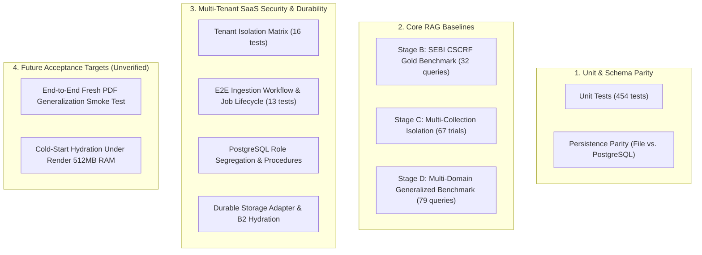

# Evaluation & Benchmark Strategy

## 1. Evaluation Objectives & Verification Principles

The evaluation framework measures retrieval accuracy, evidence grounding, temporal supersession resolution, citation precision, and strict multi-tenant isolation across both specialized regulatory collections and general document corpora.

### Core Ground Truth Principles
- **Zero Hallucinated Metrics:** Every reported metric derives directly from executed test suites and benchmark runs against verified datasets.
- **Permanent SEBI Regression Anchor:** The initial 5-circular SEBI CSCRF corpus (`sebi_cscrf_2024_113`, `2025_045`, `2025_060`, `2025_096`, `2025_119`) and its 32 golden queries in [`evaluation/data/gold_evaluation_dataset.json`](file:///c:/Users/Raja/OneDrive/Desktop/sebi-rag-assistant/evaluation/data/gold_evaluation_dataset.json) serve as a permanent regression anchor across all platform enhancements.
- **Dual Policy Verification:** Evaluates both `REGULATORY_TEMPORAL` (directed supersession graph traversal for regulatory circulars) and `GENERAL_STATIC` (passthrough policy for general documents).

---

## 2. Evaluation Suite Taxonomy

---

## 3. Verified Benchmark Results (Historical & Accepted)

### 3.1. Stage B: CSCRF Gold Retrieval Benchmark (32 Queries)
Executed against [`evaluation/data/gold_evaluation_dataset.json`](file:///c:/Users/Raja/OneDrive/Desktop/sebi-rag-assistant/evaluation/data/gold_evaluation_dataset.json) (28 answerable queries, 4 controlled abstentions):

| Retrieval System | Document MRR | Recall@1 | Recall@3 | Recall@5 | Chunk MRR | Chunk Recall@5 | Verification Status |
| :--- | :---: | :---: | :---: | :---: | :---: | :---: | :--- |
| **BM25 Lexical** | 0.9315 | 0.7500 | 0.9464 | 0.9821 | 0.6134 | 0.7321 | Verified (Active deployed web engine) |
| **Dense Vector (bge-small)** | 0.9226 | 0.7143 | 0.9464 | 0.9464 | 0.6685 | 0.7679 | Verified (Local / Target engine) |
| **Hybrid RRF ($k=60$)** | **0.9375** | **0.7500** | **0.9107** | **0.9464** | **0.6733** | **0.8393** | Verified (Local / Target engine) |

*Head-to-head pairwise chunk MRR across 28 answerable queries: RRF Hybrid wins = 9, BM25 wins = 5, Ties = 14.*

### 3.2. Stage C: Multi-Collection Isolation Benchmark (67 Trials)
Executed across `sebi_cscrf` and `cisa_playbooks` using `backend/tests/test_multi_collection_isolation.py`:
- **Total Raw Candidates Examined:** 1,138
- **Total Returned Excerpts Examined:** 224
- **Cross-Collection Leaking Excerpts:** 0 (**0.0000% Leakage Rate — PASS**)
- **Total Citations Examined:** 140
- **Cross-Collection Leaking Citations:** 0 (**0.0000% Citation Leakage Rate — PASS**)
- **HTTP Query Failures:** 0 (**0.0000% Failure Rate**)

### 3.3. Stage D: Multi-Domain Generalized Benchmark (79 Curated Queries)
Ratified in ADR-026 and executed via `evaluation/stage_d_benchmark.py`:

| Collection ID | Corpus | Policy Strategy | Queries | Answerable | Abstentions | Pinned Snapshot ID |
| :--- | :--- | :--- | :---: | :---: | :---: | :--- |
| `sebi_cscrf` | 5 SEBI CSCRF Circulars (168 chunks) | `REGULATORY_TEMPORAL` | 32 | 28 | 4 | `snap_20261011_104512_23a014` |
| `cisa_playbooks` | 2 CISA Incident Playbooks (267 chunks) | `GENERAL_STATIC` | 15 | 10 | 5 | `snap_20261030_093345_cd6f0d` |
| `general_synthetic` | 1 Acme System Handbook (30 chunks) | `GENERAL_STATIC` | 32 | 21 | 11 | `snap_20261022_062310_395f75` |
| **Consolidated Total** | **3 distinct collections** | **Dual policy validation** | **79** | **59** | **20** | **100% Pinned Snapshots** |

**Benchmark Execution Metrics (Artifact: `diagnostic_stage_d_benchmark_20261103_134159.json`):**
- **Overall Cross-Collection Leakage Rate:** **0.0000%** (Mandatory Pass/Fail Gate: PASS)
- **Primary Recall@5 (59 Answerable Queries):** **0.9492 (94.92%)** (Exceeds descriptive target $\ge 0.8500$)
- **Mean Reciprocal Rank (MRR):** **0.8099** (Exceeds descriptive target $\ge 0.7000$)
- **Controlled Abstention Correctness:** 20/20 (100% clean abstentions with zero foreign candidate leakage)
- **Execution Failures:** 0 / 79 queries

### 3.4. Multi-Tenant Security & Durability Suites
- **Tenant Isolation Matrix (`test_tenant_isolation_matrix.py`):** 16 passed. Validates that Workspace B receives HTTP 404 when querying Workspace A's collections, documents, or query history.
- **E2E Ingestion Workflow (`test_e2e_ingestion_workflow.py`):** 13 passed. Validates atomic worker procedures (`claim_ingestion_job`, `worker_create_version`, `worker_write_chunks_batch`, `complete_ingestion_job`), lease heartbeats, and stale job recovery.
- **Milestone 8 Quality Gate (14 modules):** 157 passed, 0 failed in 100.40s.

---

## 4. Evaluation Metrics & Threshold Definitions

### 4.1. Retrieval & Ranking Metrics
- **Recall@k:** Proportion of answerable queries where at least one verified gold chunk appears in the top $k$ candidates ($k=1, 3, 5$).
- **Mean Reciprocal Rank (MRR):** Average reciprocal rank of the first relevant gold chunk:
  $$\text{MRR} = \frac{1}{|Q|} \sum_{i=1}^{|Q|} \frac{1}{\text{rank}_i}$$
- **Provision Precision:** Proportion of retrieved chunks directly matching queried specific clauses.

### 4.2. Grounding, Citation & Safety Metrics
- **Citation Precision:** Proportion of generated citations that accurately resolve to a valid document ID, 1-indexed PDF page number, and authentic source text. Target: **100.0%**.
- **Refusal Precision:** Accuracy of controlled abstentions (`disposition: CONTROLLED_ABSTENTION`) against unanswerable queries under the 5-point refusal rubric. Target: **100.0%**.
- **Extractive Character Fidelity:** For verbatim excerpts, percentage of text matching source chunk strings with 100% character identity.

### 4.3. Multi-Tenant Security Metrics
- **Negative Cross-Tenant Leakage:** Percentage of candidates, citations, or metadata from Tenant $A$ appearing in queries from Tenant $B$. **Mandatory Gate: 0.0000%**.
- **Cross-Tenant Enumeration Resistance:** Percentage of unauthorized access attempts returning HTTP 404 Not Found (rather than HTTP 403 Forbidden). Target: **100.0%**.

---

## 5. Future Evaluation Targets & Acceptance Tests (Milestone 5)

The following evaluation targets represent unverified future acceptance criteria scheduled for **Milestone 5**:

1. **Unfamiliar PDF Ingestion & Retrieval Acceptance:**
   - Ingest a previously unseen multi-page PDF (e.g. standard open-source technical specification or corporate policy) via browser upload.
   - Verify 100% automated transition from `queued` $\to$ `completed`.
   - Submit 5 domain-specific factual questions; verify all answers contain accurate citations matching PDF pages.
2. **Persistence Across Container Restarts:**
   - Restart the Render Web Service container.
   - Re-query the uploaded document; verify that cold-start snapshot hydration from Backblaze B2 succeeds without missing indices or data loss.
3. **Dual-Tenant End-to-End Walkthrough:**
   - Register User 1 and User 2.
   - User 1 uploads Document A to Workspace A. User 2 uploads Document B to Workspace B.
   - Verify User 1 cannot search Document B, and User 2 cannot search Document A.
